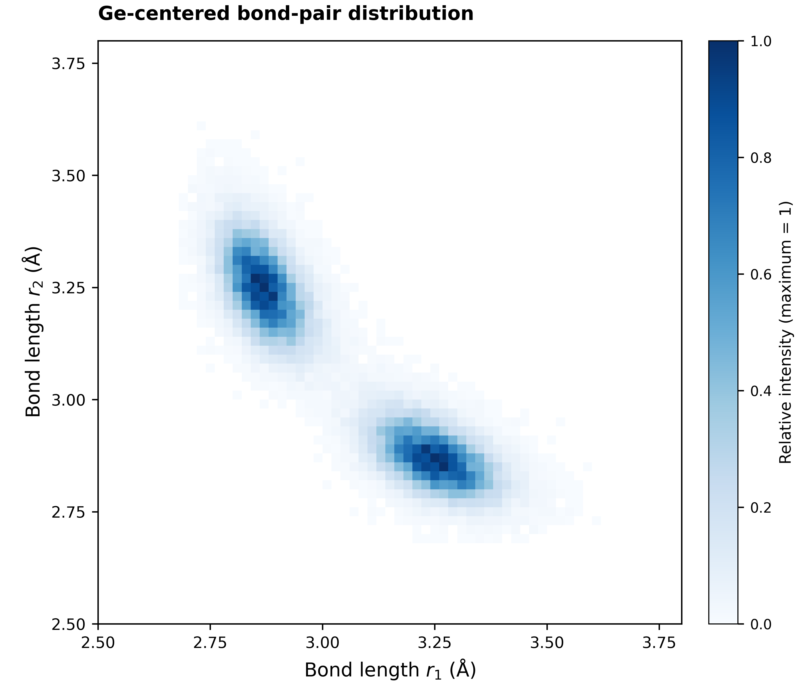
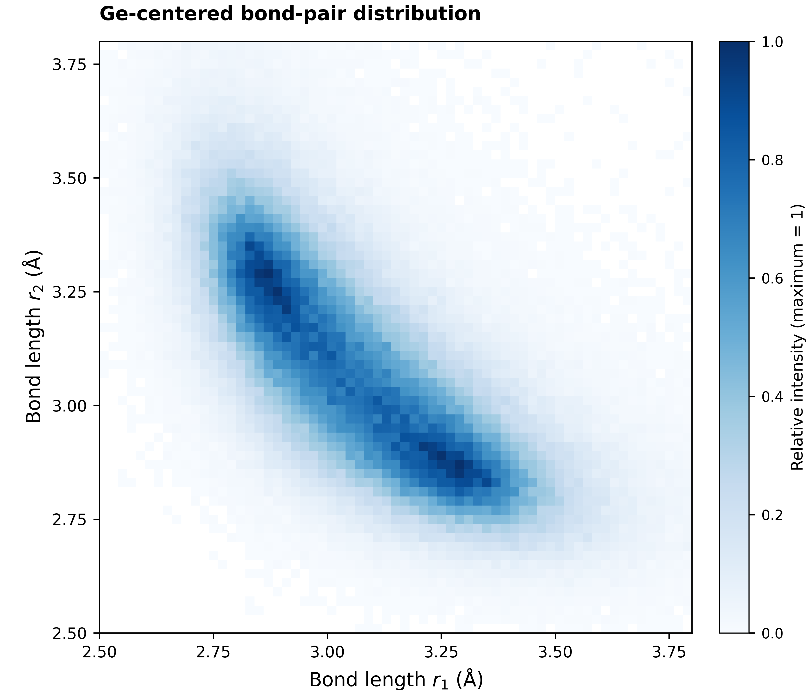

# ALTBC Analyzer

## Project Overview / 项目简介

ALTBC Analyzer is a Python library for angular-limited three-body correlation (ALTBC) analysis of atomistic structures. It uses ASE to read structures, supports periodic cells and element selection, and exports high-resolution PNG figures.

ALTBC Analyzer 是用于原子结构角度限制三体关联（ALTBC）分析的 Python 库。使用 ASE 读取结构，支持周期晶胞和元素筛选，并可导出高清 PNG 图片。

## Example Results / 结果示例

Ge-centered ALTBC histograms from the bundled structure and the full 200-frame trajectory. Both use a 155–180° angular window, 0.02 Å bins, and maximum-normalized counts without smoothing. Click either image for the 600 dpi original.

以下为示例结构及完整 200 帧轨迹的 Ge 中心 ALTBC 图，角度范围 155–180°、网格宽度 0.02 Å，以最大计数归一化，未经平滑。点击图片可查看 600 dpi 原图。

| Single Structure / 单个结构 | Trajectory / 轨迹 |
|:---:|:---:|
| [](example/figures/poscar_ge.png) | [](example/figures/trajectory_ge.png) |

## File Structure / 文件结构

```text
altbc_analyzer/
├── altbc_analyzer/
│   ├── __init__.py
│   ├── __main__.py
│   ├── altbc_analyzer.py
│   ├── neighbor_list.py
│   └── plotting.py
├── example/
│   ├── figures/
│   ├── POSCAR
│   ├── test.xyz
│   ├── quickstart.ipynb
│   └── make_figures.py
├── tests/
├── LICENSE
├── MANIFEST.in
├── README.md
└── pyproject.toml
```

## Installation / 安装

Requires Python 3.9 or later. Installation in a virtual environment is recommended.

需要 Python 3.9 或更高版本，建议在虚拟环境中安装。

```bash
git clone https://github.com/wangchr1617/altbc_analyzer.git
cd altbc_analyzer
python3 -m venv .venv
source .venv/bin/activate
python -m pip install --upgrade pip
python -m pip install .
```

## Usage / 使用方法

### Command Line / 命令行

```bash
# Single structure / 单个结构
altbc example/POSCAR --center Ge -o outputs/structure.png

# Trajectory / 轨迹
altbc example/test.xyz --trajectory --center Ge --stride 1 \
  --bin-width 0.02 --dpi 600 -o outputs/trajectory.png

# Available options / 查看参数
altbc --help
```

The command saves a PNG figure, a raw histogram with metadata (`.npz`), and a summary (`.json`). PNG output defaults to 600 dpi. The `outputs/` directory is local and ignored by Git.

命令会保存 PNG 图片、包含元数据的原始网格（`.npz`）和统计摘要（`.json`）。PNG 默认采用 600 dpi。`outputs/` 仅用于本地结果，已被 Git 忽略。

### Python

```python
from altbc_analyzer import ALTBCAnalyzer

analyzer = ALTBCAnalyzer(
    "example/POSCAR",
    center_element="Ge",
    apply_mic=True,
    cutoff=4.0,
    theta_min=155,
    theta_max=180,
    grid_size=0.02,
)
fig, ax = analyzer.plot_grid("outputs/altbc.png", dpi=600)
analyzer.save_grid("outputs/altbc.npz")
```

For trajectories, set `filetype="MultiSystem"` and `frame_interval=1` to process every frame. Use `neighbor_element` to select the neighbor species. In Python, enable `apply_mic=True` to use the structure's periodic boundary flags; the CLI does this by default. Use `--no-pbc` for a finite cluster.

处理轨迹时，设置 `filetype="MultiSystem"` 和 `frame_interval=1` 可分析全部帧；使用 `neighbor_element` 筛选邻居元素。Python 接口需设置 `apply_mic=True` 才会使用结构的周期边界标记，命令行默认启用；有限团簇可使用 `--no-pbc`。

Each selected neighbor pair contributes both ordered directions. Figures show unsmoothed histograms, normalized to their maximum by default. Other `normalization` options are `"none"` (raw counts), `"density"` (probability density within the displayed window), and `"per_center"` (counts per selected center per bin area).

每对符合条件的邻居均计入两个有序方向。图片显示未经平滑的直方图，默认除以本图最大值。`normalization` 还支持 `"none"`（原始计数）、`"density"`（显示窗口内的概率密度）和 `"per_center"`（按选定中心原子总数及格面积归一化）。

More examples are available in [quickstart.ipynb](example/quickstart.ipynb) and [make_figures.py](example/make_figures.py).

更多示例见 [quickstart.ipynb](example/quickstart.ipynb) 和 [make_figures.py](example/make_figures.py)。

## Citation / 引用

If you use this work, please cite the following DOI.

使用本工作时，请引用以下 DOI：

[10.1103/w7ll-dsct](https://doi.org/10.1103/w7ll-dsct)

## Contribution / 贡献

Issues and Pull Requests are welcome. For questions, please contact the project maintainer by [email](mailto:wangchr1617@gmail.com).

欢迎提交 Issue 和 Pull Request。如有问题，可通过[电子邮件](mailto:wangchr1617@gmail.com)联系项目维护者。

```bash
python -m pip install -e '.[dev]'
MPLBACKEND=Agg pytest -q
```

## License / 许可证

This project is open-sourced under the MIT license. See [LICENSE](LICENSE) for details.

本项目基于 MIT 许可证开源，详见 [LICENSE](LICENSE)。
